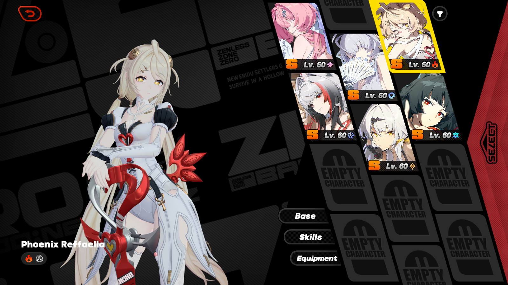
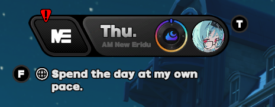
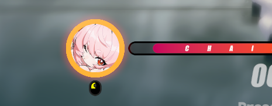

# ZZZ Mindscape Icons Mod
This mod replaces most instances of Zenless Zone Zero's agent icons with their Mindscape artworks. For the mod download,
see [releases](https://github.com/brewffee/ZZZ-Mindscape-Icons-Mod/releases).

Included in the repository are the Python generator and a visual `editor.py` desktop tool.
Agent image properties and game texture hashes are stored in `agents.json`, source
artwork is in `sources`, and generator settings are in `config.json`.



## Installation
The latest version of this mod can be found in the [releases](https://github.com/brewffee/ZZZ-Mindscape-Icons-Mod/releases) 
page.

## Screenshots
|  |  |
|:---------------------------------------:|:--------------------------------------:|
|              **Overworld**              |            **Chain Attack**            |

|  |
|:---------------------------------------:|
|        **Agent Selection Tabs**         |

## Building
### Prerequisites
- Python 3.12
- [Pillow](https://pypi.org/project/pillow/) library:
  ```powershell
  python -m pip install Pillow
  ```

### Visual editor

```powershell
python editor.py
```

Use the editor to choose an agent and image, adjust how the image fits, then
save your changes. When you're ready, choose **Generate Mod** to create the files
for the game. If you have unsaved changes, the editor will ask whether to save
them first.

An image is shared across that agent's icon shapes, so changing it may affect
more than one screen. Check the previews before generating the mod.
When importing artwork, the editor asks whether to flip it vertically. Choose
Yes when your image is right-side up so that the resulting mod is correctly
orientated.

### Edit configuration

Most users can leave the settings as they are. To change them, choose **Edit
Config** in the editor. You can also edit `config.json` directly, but close the
editor first. The settings control the mod name, image variants, output folder,
and image appearance.

### Command-line generation

```powershell
python main.py
```

This creates the mod files in the `export` folder. Copy the generated mod folder
into ZZMI's Mods folder to use it in the game.

**Warning:** By default, generating the mod replaces the contents of the
configured output folder.

## Planned Features
> [!IMPORTANT]
> While I would like to implement these soon, the resources for these screens 
> are used in many different places of the game. Replacing these resources
> would require a lot of additional work and possibly a rewrite of the 
> generator, nor could I guarantee these replacements will function
> correctly across game updates.

I plan to support additional sections in the future, including:
- [ ] Character Selection screen portraits
- [ ] Agent Trust screen icons
- [ ] Agent Display portraits
- [ ] Preset Config icons

If you have the hashes for these, please let me know by creating an [issue](https://github.com/brewffee/ZZZ-Mindscape-Icons-Mod/issues/new)!!!